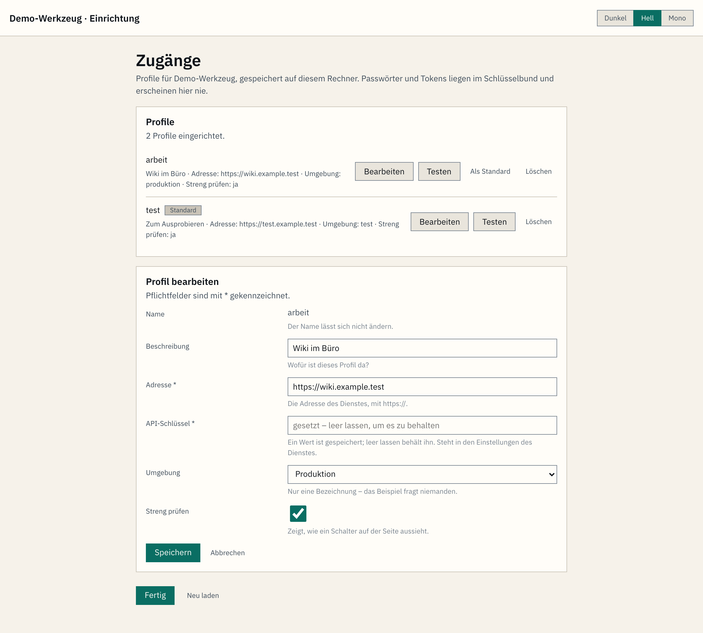

# quiver-tools

> **Status: in Arbeit.** Spezifikation in [SPEC.md](SPEC.md).

Eigene MCP-Tools für [mcp-quiver](https://github.com/patimweb-labs/mcp-quiver) in reinem Rust: **Outline-Wiki**, **E-Mail** (IMAP/SMTP), **SSH/SFTP** und **ABAP** (SAP ADT). Zugänge richtest du auf einer Einrichtungsseite im Browser ein – Passwörter und API-Keys gehen nie durch einen Agenten.

## Die Einrichtungsseite

Jedes Tool bringt seine eigene Seite mit: `quiver-<tool> einrichten`. Sie läuft nur auf
`127.0.0.1`, trägt ein zufälliges Einmal-Token im Pfad und schließt sich nach „Fertig“ oder
nach 30 Minuten ohne Anfrage. Profile (mehrere Wikis, Postfächer, Hosts, Systeme) legt man
dort an, ändert sie, setzt einen Standard, prüft die Verbindung und löscht sie wieder.
Geheimnisse liegen im Schlüsselbund des Systems; die Seite zeigt nur „gesetzt“.




## Entwickeln

```bash
# alles prüfen (der Befehl vor jedem Commit)
cargo fmt --all --check && cargo clippy --all-targets -- -D warnings && cargo test --workspace

# die Einrichtungsseite des Beispiel-Werkzeugs ansehen (ohne Schlüsselbund)
QUIVER_TOOLS_TRESOR=speicher cargo run -p quiver-tools-kern --example demo -- einrichten

# MCP über stdio, so wie quiver das Tool startet
QUIVER_TOOLS_TRESOR=speicher cargo run -p quiver-tools-kern --example demo
```

Zwei Umgebungsvariablen helfen beim Ausprobieren:

| Variable | Wirkung |
|---|---|
| `QUIVER_TOOLS_DIR` | verlegt den Ordner der Profile (statt `<konfig>/quiver-tools`) |
| `QUIVER_TOOLS_TRESOR=speicher` | Geheimnisse nur im Arbeitsspeicher – nie für echte Zugänge |

Aufbau, Bausteine und Datenfluss: [docs/architektur.md](docs/architektur.md).

## Lizenz

[MIT](LICENSE)
