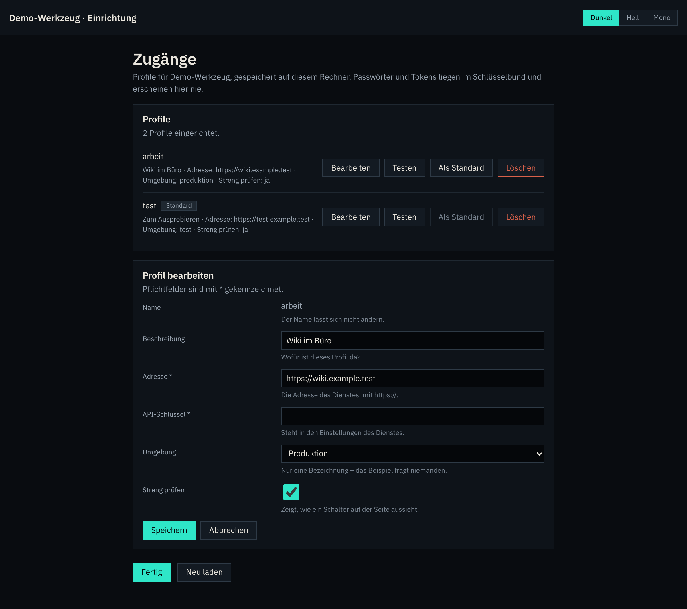

# quiver-tools

> **Status: in Arbeit.** Spezifikation in [SPEC.md](SPEC.md).

Eigene MCP-Tools für [mcp-quiver](https://github.com/patimweb-labs/mcp-quiver) in reinem Rust: **Outline-Wiki**, **E-Mail** (IMAP/SMTP), **SSH/SFTP** und **ABAP** (SAP ADT). Zugänge richtest du auf einer Einrichtungsseite im Browser ein – Passwörter und API-Keys gehen nie durch einen Agenten.

## Die Einrichtungsseite

Jedes Tool bringt seine eigene Seite mit: `quiver-<tool> einrichten`. Sie läuft nur auf
`127.0.0.1`, trägt ein zufälliges Einmal-Token im Pfad und schließt sich nach „Fertig“ oder
nach 30 Minuten ohne Anfrage. Profile (mehrere Wikis, Postfächer, Hosts, Systeme) legt man
dort an, ändert sie, setzt einen Standard, prüft die Verbindung und löscht sie wieder.
Geheimnisse liegen im Schlüsselbund des Systems; die Seite zeigt nur „gesetzt“.




## quiver-outline (Outline wiki)

`quiver-outline` is the first of the four tools: it reads, searches and edits an
[Outline](https://www.getoutline.com/) wiki – cloud or self-hosted – without the API
key ever passing through a model.

Setup (once):

1. In Outline: **Settings → API & Apps** → create an API key (it starts with `ol_api_`).
2. `quiver-outline einrichten` (or the **Einrichten** button in quiver) → add a profile
   with the workspace address and the key → **Verbindung testen** → **Fertig**.
3. As many profiles as you like (several wikis); the first one becomes the default.

The address is forgiving: a bare host, a trailing slash, a pasted `/api` base or the
`/mcp` endpoint from Outline's MCP docs are all normalised to the workspace root.

### Tools

Every tool takes `profil` (optional); without it the default profile is used. Without
any profile each tool answers with the setup hint instead of an error.

| Tool | Kind | What it does |
|---|---|---|
| `outline_collections` | read | List collections with their ids |
| `outline_structure` | read | Nested document tree of one collection |
| `outline_search` | read | Full-text search with collection, status and date filters; `alle_profile` searches every profile |
| `outline_list` | read | List documents: recent, by collection, by parent, or your own drafts |
| `outline_read` | read | Read a document's markdown body, optionally with child documents or saved to a file |
| `outline_comments` | read | Comment threads of a document, nested by reply |
| `outline_profile` | read | The configured profiles, without secrets |
| `outline_create` | write | Create a document in a collection or under a parent document |
| `outline_update` | write | Replace, append to or prepend to a body; rename; publish a draft |
| `outline_move` | write | Move a document to another collection or parent |
| `outline_archive` | write | Archive, restore or unpublish a document |
| `outline_delete` | write | Move a document to the trash, or delete it permanently |
| `outline_comment` | write | Post a comment or a reply |
| `outline_export` | write | Write a document (optionally with children) or a whole collection to local `.md` files |

A few details the agent relies on:

- `outline_read` truncates the body after `max_zeichen` characters (default 8000,
  `0` means no limit) and says how much it left out.
- `outline_search` with `alle_profile: true` searches every profile, labels each hit
  with the profile it came from and reports unreachable wikis separately. Ids are only
  valid inside their own profile, so read a hit with the same `profil`.
- `outline_export` always needs a `target_dir`; file names are derived from the title,
  never from the id alone, and cannot leave that directory.
- Outline errors become MCP errors with status and text – never with the API key.

### Entry for mcp-quiver

The tool is an own binary (no npm/pypi package), so the complete entry lives under
`_meta`:

```json
{
  "name": "io.github.patimweb-labs.quiver-outline",
  "title": "Outline-Wiki",
  "description": "Outline-Wiki lesen, schreiben, sortieren und kommentieren.",
  "version": "0.1.0",
  "_meta": {
    "io.github.patimweb-labs.quiver/eintrag": {
      "id": "quiver-outline",
      "version": "0.1.0",
      "titel": "Outline-Wiki",
      "beschreibung": "Outline-Wiki lesen, schreiben, sortieren und kommentieren.",
      "herkunft": "eigen",
      "laufzeit": {
        "art": "stdio",
        "befehl": "quiver-outline",
        "argumente": [],
        "umgebung": {}
      },
      "felder": [],
      "aktiv": true,
      "einrichtung": { "einrichten": ["einrichten"] }
    }
  }
}
```

`felder` stays empty on purpose: address and API key are profile values on the setup
page, not environment variables. `einrichtung.einrichten` is the argument list quiver
runs with the same binary and environment – it opens the page in the browser and ends
with exit 0 (something saved) or 1.

## Entwickeln

```bash
# alles prüfen (der Befehl vor jedem Commit)
cargo fmt --all --check && cargo clippy --all-targets -- -D warnings && cargo test --workspace

# die Einrichtungsseite des Beispiel-Werkzeugs ansehen (ohne Schlüsselbund)
QUIVER_TOOLS_TRESOR=speicher cargo run -p quiver-tools-kern --example demo -- einrichten

# MCP über stdio, so wie quiver das Tool startet
QUIVER_TOOLS_TRESOR=speicher cargo run -p quiver-tools-kern --example demo
```

Zwei Umgebungsvariablen helfen beim Ausprobieren:

| Variable | Wirkung |
|---|---|
| `QUIVER_TOOLS_DIR` | verlegt den Ordner der Profile (statt `<konfig>/quiver-tools`) |
| `QUIVER_TOOLS_TRESOR=speicher` | Geheimnisse nur im Arbeitsspeicher – nie für echte Zugänge |

Die Bilder in diesem Dokument entstehen aus der laufenden Seite: `examples/demo`
serviert sie mit `QUIVER_TOOLS_KEIN_BROWSER=1` ohne Fenster, `docs/bilder/erzeugen.mjs`
fotografiert sie dunkel und hell mit Playwright (geliehen aus mcp-quiver, damit dieses
Projekt keine Node-Abhängigkeit bekommt):

```bash
node docs/bilder/erzeugen.mjs
```

Aufbau, Bausteine und Datenfluss: [docs/architektur.md](docs/architektur.md).

## Lizenz

[MIT](LICENSE)
